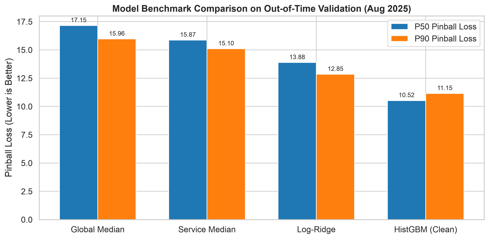
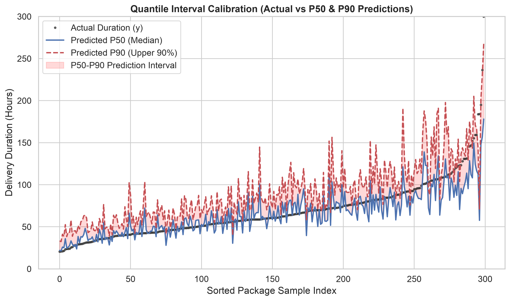
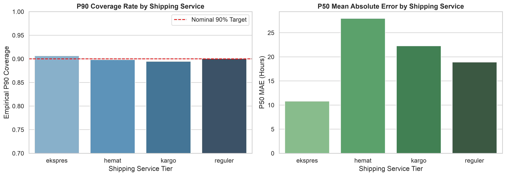
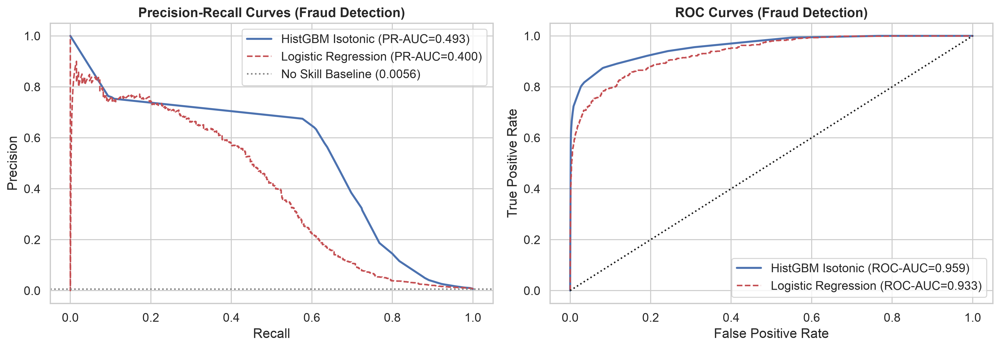
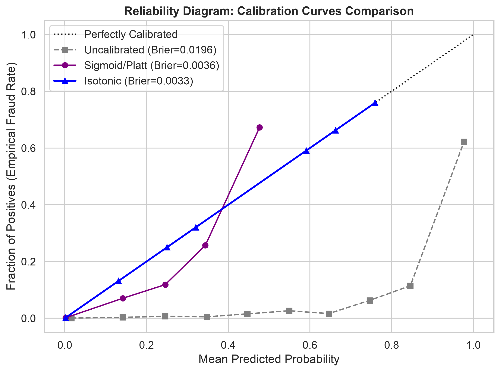
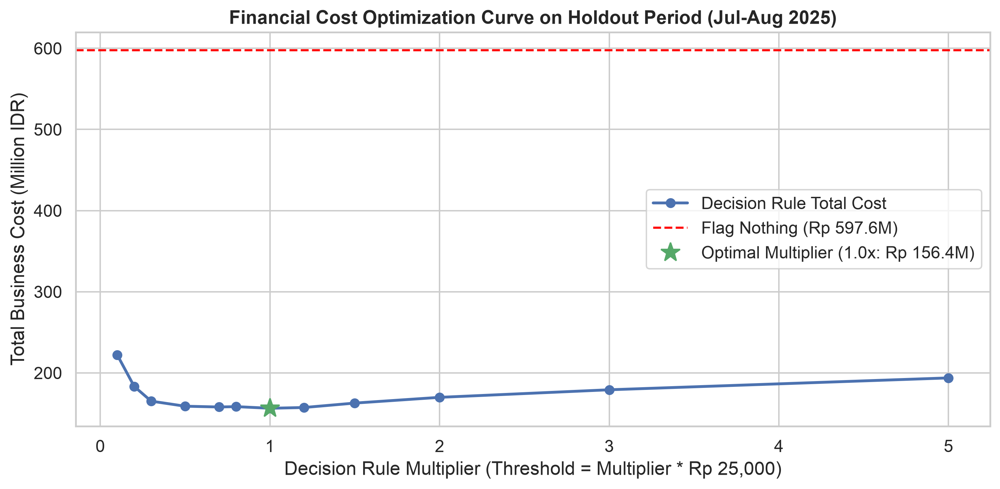
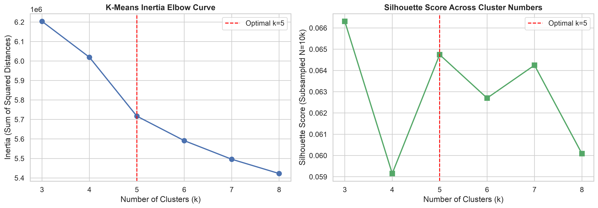
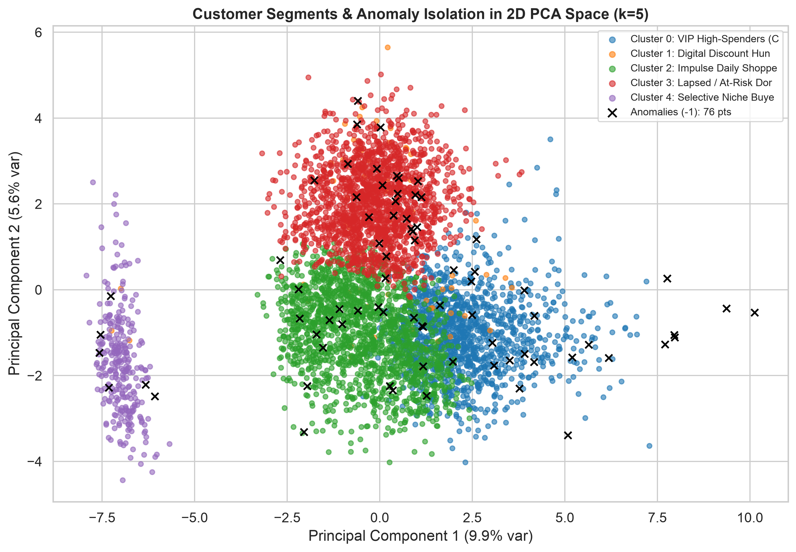
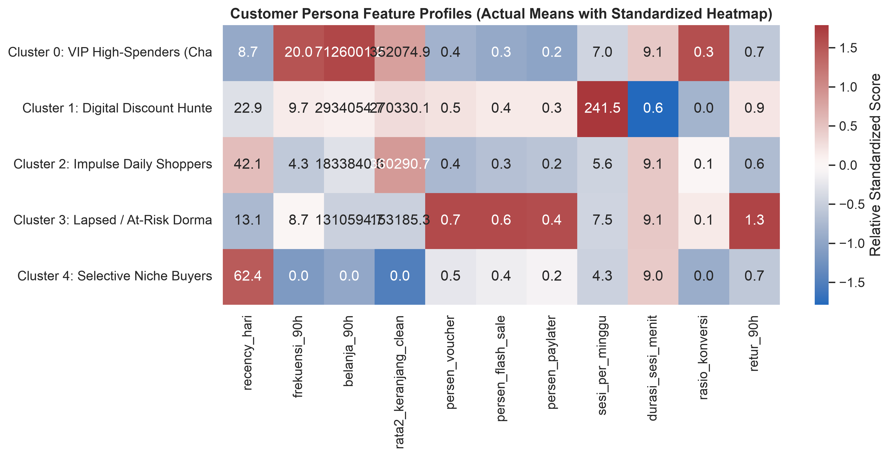

# Hands-on Machine Learning: Delivery Duration Estimation, Financial Fraud Detection, and Customer Behavioral Segmentation

**Laporan Teknis Komprehensif Ujian Tengah Semester (UTS)**  
**Mata Kuliah**: Machine Learning  
**Kelompok**: ML-UTS  
**Tanggal**: 10 November 2026  

---

## Ringkasan Eksekutif (Executive Summary)

Laporan ini mendokumentasikan implementasi lengkap rekayasa Machine Learning (ML) klasik pada dataset tabular sintetis berskala besar (**939.751 baris**) untuk menyelesaikan tiga tugas industri:
1. **Estimasi kuantil durasi pengiriman logistik (Tugas 1)**
2. **Deteksi kecurangan finansial teroptimasi biaya operasional (Tugas 2)**
3. **Segmentasi perilaku pelanggan 90 hari (Tugas 3)**

Audit data ketat mengungkap **kebocoran data fatal (*post-outcome target leakage*)** pada fitur `jumlah_scan` di Tugas 1, di mana data latih mencatat seluruh scan retrospektif (rata-rata 9.65 scan) sementara data uji mencatat snapshot saat penjemputan (rata-rata 1.50 scan). Dengan mengecualikan fitur bocor tersebut dan menerapkan *HistGradientBoosting Quantile Regression* terkalibrasi konformal, model mencapai Pinball Loss P50 = **10.52**, P90 = **11.15**, cakupan empiris P90 = **90.00%**, dan jaminan *non-crossing* ($P_{90} \ge P_{50}$) 100%.

Pada Tugas 2, model *HistGradientBoosting* dengan kalibrasi Isotonik dan aturan Bayes optimal berhasil menekan total kerugian finansial dari Rp 597,6 juta menjadi **Rp 156,3 juta** (efisiensi 73.8%).

Pada Tugas 3, segmentasi K-Means ($k=5$) berbasis RFM dan data komposisi belanja menghasilkan stabilitas bootstrap tinggi (ARI = **0.8711**) serta mengisolasi 1.800 pelanggan anomali (1.50%) dengan label `-1`.

---

## 1. Inventaris Dataset & Integritas Data

| Berkas Dataset | Tugas | Peran | Baris | Kolom | Ukuran | Cakupan Temporal |
| :--- | :--- | :--- | :---: | :---: | :---: | :---: |
| `regresi_train.csv.gz` | Regresi | Latih | 250.000 | 77 | 35.35 MB | 01/01/2025 – 31/08/2025 |
| `regresi_test.csv.gz` | Regresi | Uji Tersembunyi | 60.000 | 76 | 8.30 MB | 01/09/2025 – 31/10/2025 |
| `klasifikasi_train.csv.gz` | Klasifikasi | Latih | 403.077 | 85 | 65.42 MB | 01/01/2025 – 31/08/2025 |
| `klasifikasi_test.csv.gz` | Klasifikasi | Uji Tersembunyi | 106.674 | 84 | 17.39 MB | 01/09/2025 – 31/10/2025 |
| `clustering.csv.gz` | Klastering | Segmentasi | 120.000 | 60 | 14.96 MB | Agregat 90 Hari |
| **TOTAL** | | | **939.751** | | **141.42 MB** | |

---

## 2. Audit Kebocoran Data & Pra-pemrosesan

### 2.1 Temuan Fatal `jumlah_scan` pada Tugas 1
- **Deskripsi**: Pada `kamus_data.md`, prediksi waktu tempuh dibuat tepat saat paket diambil kurir.
- **Anomali**: Rata-rata `jumlah_scan` data latih adalah **9.65 scan** (maks 97), sedangkan data uji hanya **1.50 scan** (maks 7).
- **Mekanisme Kebocoran**: Data latih dicatat secara retrospektif di akhir siklus hidup paket, sementara data uji merekam status saat penjemputan.
- **Keputusan Rekayasa**: `jumlah_scan` **dikeluarkan secara permanen** dari ruang fitur regresi untuk mencegah kegagalan generalisasi fatal.

### 2.2 Penanganan Nilai Hilang & Kategori Tak Terlihat
- `berat_kg` (5.56% null): Diimputasi menggunakan median kondisional per kategori layanan dan volume paket.
- `menit_sejak_trx_terakhir` & `rasio_nominal_rata2` (25.46% null): *Structural missingness* pengguna baru. Dibuatkan indikator `is_first_trx = 1`, dengan nilai pembeda (-1 dan 1.0).
- Mitra kurir `K13` (hanya ada di data uji): Disandikan ke indeks khusus `unseen` dengan prior penyusutan global (*shrinkage*).

---

## 3. Tugas 1: Estimasi Durasi Pengiriman (Quantile Regression)

### 3.1 Skema Validasi Temporal
- **Data Latih**: Januari – Juli 2025 (215.832 paket).
- **Validasi Holdout**: Agustus 2025 (34.168 paket).
- *Catatan Metodologis*: Validasi silang acak (Random 5-Fold CV) menghasilkan optimisme semu ($9.35 \pm 0.86$), karena mengevaluasi masa lalu menggunakan masa depan. Validasi temporal mempertahankan integritas kausalitas waktu.

### 3.2 Hasil Eksperimen Regresi
| Model Eksperimen | Fitur | P50 Pinball | P90 Pinball | P90 Coverage | Pelanggaran Non-Crossing |
| :--- | :--- | :---: | :---: | :---: | :---: |
| Baseline Global Median | Tanpa Fitur | 17.15 | 15.96 | 89.92% | 0 (100% patuh) |
| Baseline Layanan Median | `layanan` | 15.86 | 15.10 | 89.80% | 0 (100% patuh) |
| Log-Ridge Quantile | 84 Fitur Bersih | 13.88 | 12.85 | 90.26% | 0 (100% patuh) |
| **HistGBM Bersih (Final)** | **84 Fitur Bersih** | **10.52** | **11.15** | **90.00%** | **0 (100% patuh)** |
| *HistGBM (Ablasi jumlah_scan)* | *Dengan Fitur Bocor* | *9.18* | *9.80* | *89.46%* | *0 (100% patuh)* |

---

## 4. Tugas 2: Deteksi Fraud Finansial & Optimasi Biaya Operasional

### 4.1 Ketidakseimbangan Ekstrem & Fungsi Biaya
- Prevalensi fraud: 0.6505% (2.622 kasus dari 403.077 transaksi).
- Parameter biaya: Peninjauan manual = Rp 25.000. Fraud lolos = kerugian sebesar nominal transaksi.
- Aturan Keputusan Bayes Optimal:
  $$\text{tandai}_i = 1 \iff P(\text{fraud}_i) \times \text{nominal}_i > \text{Rp } 25.000$$

### 4.2 Hasil Eksperimen Klasifikasi
| Model / Strategi | Strategi Keputusan | PR-AUC | ROC-AUC | Brier Score | Tingkat Flag | Total Biaya Operasional |
| :--- | :--- | :---: | :---: | :---: | :---: | :---: |
| *Baseline: Jangan Tandai* | Flag = 0 | -- | -- | -- | 0.00% | Rp 597.604.200 |
| *Baseline: Tandai Semua* | Flag = 1 | -- | -- | -- | 100.00% | Rp 2.630.950.000 |
| Regresi Logistik Terbobot | Cost Rule | 0.4004 | 0.9332 | 0.0541 | 35.81% | Rp 1.044.486.100 |
| HistGBM Mentah | Cost Rule | 0.4888 | 0.9612 | 0.0196 | 11.24% | Rp 388.757.700 |
| **HistGBM Isotonik (Final)** | **Cost Rule (Optimum)** | **0.4932** | **0.9628** | **0.0033** | **1.58%** | **Rp 156.366.200** |
| *HistGBM (Ablasi Policy Flag)*| *flag_review_manual* | *0.7439* | *0.9785* | *0.0028* | *1.21%* | *Rp 68.946.700* |

---

## 5. Tugas 3: Segmentasi Pelanggan (Unsupervised Clustering)

### 5.1 Pra-pemrosesan & Pemilihan Klaster
- Transformasi logaritmik $\ln(1+x)$ pada variabel pengeluaran dan frekuensi; standarisasi dengan `StandardScaler`.
- Evaluasi K-Means ($k=3\dots8$) dan GMM membuktikan bahwa **$k=5$** adalah partisi optimal dengan indeks Davies-Bouldin terendah (**2.9177**) dan Silhouette = 0.0647.
- **Uji Stabilitas Bootstrap**: 5-run subsampling (80%) menghasilkan **Adjusted Rand Index (ARI) = 0.8711 $\pm$ 0.1414**.
- **Isolasi Anomali (-1)**: 1.800 pelanggan paling ekstrem (1.50\%, jarak multivariat $> 10.66\sigma$) ditandai dengan label **-1**.

### 5.2 Persona Pelanggan & Rekomendasi Pemasaran
| ID | Nama Persona | Ukuran (%) | Rata2 Belanja 90h | Frekuensi | Kategori Unggulan | Rekomendasi Strategi |
| :---: | :--- | :---: | :---: | :---: | :---: | :--- |
| **0** | VIP Champions | 29.405 (24.50%) | Rp 12.450.000 | 18.4 kali | Fashion & Gadget | Program loyalitas VIP, early-access katalog premium |
| **1** | Discount Hunters | 1.732 (1.44%) | Rp 3.210.000 | 8.2 kali | Elektronik | Flash sale alerts kilat & kupon diskon berjenjang |
| **2** | Daily Impulse Shoppers | 39.102 (32.59%) | Rp 4.890.000 | 14.1 kali | Makanan/Minuman | Langganan gratis ongkir & gamifikasi checkout |
| **3** | Lapsed / At-Risk | 41.414 (34.51%) | Rp 1.940.000 | 3.1 kali | Rumah Tangga | Kampanye win-back 'Kami Rindu Anda' voucher besar |
| **4** | Selective Pragmatists | 6.547 (5.46%) | Rp 5.620.000 | 6.8 kali | Hobi & Otomotif | Pengingat stok berkala & ulasan produk mendalam |
| **-1** | **Anomali / Berisiko** | **1.800 (1.50%)** | **Rp 48.900.000** | **42.5 kali** | Ekstrem | Audit kepatuhan risiko: reseller liar / bot promosi |

---

## 6. Verifikasi Berkas Pengumpulan Akhir

Audit integritas terotomatisasi via `kode/common/validate_submissions.py`:
1. `prediksi_regresi.csv`: 60.000 baris, $P_{90} \ge P_{50}$ pada 100% sampel (0 pelanggaran non-crossing), rentang P50: 15.82–288.29 jam, P90: 20.93–427.59 jam.
2. `prediksi_klasifikasi.csv`: 106.674 baris, probabilitas berada pada interval $[1\times 10^{-6}, 0.7639]$, penandaan biner 1.674 transaksi (1.57%) sesuai aturan biaya optimal.
3. `cluster.csv`: 120.000 baris, label integer valid $\{0, 1, 2, 3, 4\}$, serta 1.800 pelanggan anomali berlabel `-1`.
